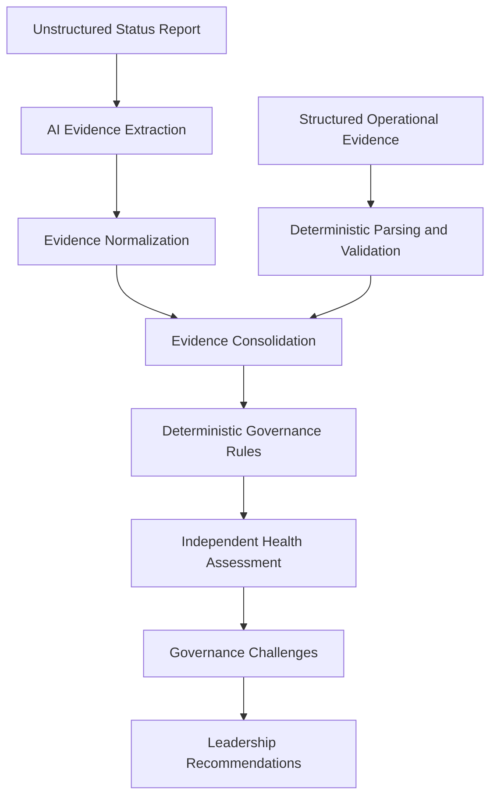

# ProgramPulse AI

**Agentic Delivery & Governance Platform**

ProgramPulse AI is an AI Delivery Assurance layer that independently examines evidence across project systems, challenges reported project health, identifies governance failures, and recommends leadership intervention.

V1 demonstrates this approach through uploaded evidence and synthetic project data.
It does not yet connect directly to project-management systems.

## Why ProgramPulse

Project status often depends on manually reported RAG health, while material risks
are distributed across status reports, RAID logs, milestone plans and quality data.
A GREEN report can coexist with an overdue critical dependency, unresolved defects
and compressed testing dates.

ProgramPulse examines those sources independently and makes disagreements visible.
Its output is a traceable basis for leadership review, beyond a summary of the PM's report.

## Core Capability

> **Reported Health: GREEN**  
> **ProgramPulse Assessment: AMBER**  
> **Status Conflict: YES**  
> **Leadership Attention: REQUIRED**

The AssessPro demonstration connects this disagreement to specific operational
findings, management claims and recommended interventions.

## How It Works



All files are validated before a paid extraction request. Normalized narrative and
operational evidence then meet in the same assessment pipeline.

## Key Design Principle

**The LLM does NOT decide GREEN / AMBER / RED.**

AI interprets unstructured evidence. Deterministic governance rules calculate health.
A faithfully extracted management claim can still be challenged by operational
facts. Extraction confidence measures source support, not whether a claim is true.

## Current V1 Capabilities

- Structured AI status-report extraction and management-claim separation.
- Evidence normalization, event association and source traceability.
- Independent six-dimension health assessment and status-conflict detection.
- Consolidated governance challenges and evidence-backed leadership actions.
- Enterprise document ingestion with deterministic column mapping.
- Executive dashboard with expandable reasoning and supporting references.
- Sample mode with no API cost; explicit Live and uploaded assessments.
- File validation before extraction, safe errors and no automatic AI retries.

## Health Dimensions

Schedule · Scope · Quality · Dependencies · Actions · Governance

## Supported Documents

- **Status report:** DOCX, text-based PDF, TXT or MD.
- **RAID log:** XLSX, CSV or JSON.
- **Milestone plan:** XLSX, CSV or JSON.
- **Quality summary:** XLSX, CSV or JSON; one summary-metrics row for tabular files.

Recommended: DOCX status report and three XLSX workbooks. Explicit project/date
headers and compatible operational fields remain required. Read the
[format and alias guide](docs/enterprise_ingestion.md) before preparing new data.

## Demo Scenario

**AssessPro Modernization & Feature Expansion** is reported GREEN but assessed
AMBER. A critical proctoring certification is nine days overdue with no revised
commitment. Eleven Sev-2 defects, reopened defects and incomplete regression add
quality pressure. Critical-path delays compress readiness while UAT stays fixed.

Dependencies is RED; Schedule, Scope, Quality, Actions and Governance are AMBER.
A RED dependency does not by itself prove the release is blocked. The rules require
an explicit release-blocker signal to make overall health RED.

The AssessPro scenario and all associated project evidence are synthetic and created solely for demonstration purposes.

Explore the [JSON/text sample](sample_data/assesspro/) or equivalent
[DOCX/XLSX sample](sample_data/assesspro_enterprise/).
[Capture instructions](docs/screenshots/README.md) describe the portfolio screenshots;
no fabricated or mislabeled Live screenshots are included.

## Tech Stack

- **Backend:** Python 3.11+, FastAPI, Pydantic, OpenAI Responses API,
  python-docx, openpyxl and pypdf for embedded PDF text.
- **Frontend:** Next.js App Router, React, TypeScript and Tailwind CSS.
- **Testing:** pytest, mocked HTTP/provider boundaries, Vitest, React Testing
  Library and jsdom.

## Running Locally

Prerequisites: Python 3.11+ and Node.js 24 LTS with npm. From the repository root:

```bash
python3 -m venv .venv
source .venv/bin/activate
python -m pip install -r backend/requirements.txt
cp -n .env.example .env
cd backend
python -m uvicorn app.main:app --reload --host 127.0.0.1 --port 8000
```

In another terminal, from the repository root:

```bash
cd frontend
npm ci
cp -n .env.example .env.local
npm run dev -- --hostname 127.0.0.1
```

Dashboard: http://localhost:3000  
API docs: http://127.0.0.1:8000/docs  
Health check: http://127.0.0.1:8000/health

Windows users can activate Python with `.venv\Scripts\activate`; copy example
configuration files using their shell's copy command. Never overwrite existing
local configuration without reviewing it.

The dashboard initially displays the local Sample fixture and works without the
backend. To assess evidence, choose **Analyze Project Evidence**, select four
files, then explicitly click **Run Assessment**. Success fills the same dashboard
in Live mode. Failure retains selections; **Start New Assessment** resets the flow.

## Environment Variables

- `OPENAI_API_KEY`: backend-only API credential in the root `.env`; required for
  extraction and Live assessments. Never put it in frontend configuration.
- `OPENAI_MODEL`: model available to your API account. The implementation's
  current default is `gpt-5.6-luna`; account access must be verified separately.
- `NEXT_PUBLIC_API_BASE_URL`: public API address in `frontend/.env.local`, normally
  `http://127.0.0.1:8000`. Restart/rebuild Next.js after changing it.

Process environment variables override the backend `.env`. Example files contain
placeholders only. Local CORS explicitly permits localhost and 127.0.0.1 on port
3000; other origins need configuration changes.

## Cost Behavior

**Sample mode = zero OpenAI API usage.** Selecting files, viewing sample evidence
and expanding challenges do not submit an assessment.

**Live assessment = one AI extraction call per valid assessment request.**
Invalid input/configuration can fail before a provider call. There is no automatic
retry, polling or cross-request cache. Repeating a run, or requesting both detailed
and summary endpoints separately, incurs separate extraction requests. Browser
cancellation does not guarantee server-side cancellation or prevent billing.

## Architecture

Start with [architecture](docs/architecture.md), then read:

- [Technical/product case study](docs/case-study.md)
- [Design decisions](docs/design-decisions.md)
- [Security and responsible AI](docs/security-and-ai.md)
- [API and diagnostics reference](docs/api-reference.md)
- [Enterprise formats and mapping](docs/enterprise_ingestion.md)
- [Four-to-five-minute demo script](docs/demo-script.md)
- [Validation results and publication checks](docs/validation.md)

## Validation

Backend, from the repository root:

```bash
cd backend
../.venv/bin/python -m pytest -q
```

Frontend, from the repository root:

```bash
cd frontend
npm test
npm run lint
npm run build
npm run typecheck
```

Build and standalone type-check run sequentially because Next.js generates types
in `.next`. For a production preview, stop the frontend dev server, build, then run
`npm start -- --hostname 127.0.0.1`. Automated tests make no paid provider requests.
See [validation.md](docs/validation.md) for actual results and caveats.

## Limitations

- No scanned-PDF OCR, authentication, persistence or assessment history.
- No Jira/Azure DevOps integrations or portfolio history.
- No arbitrary spreadsheet layouts, formula evaluation or raw-defect aggregation.
- Narrative extraction can be incomplete or incorrect despite schema/quote checks.
- Structured facts have policy precedence, but are not independently verified truth.
- Deterministic governance rules are prototype policies requiring organizational
  calibration before production use. Confidence labels are not calibrated probabilities.
- Local decision-support prototype, not an internet-ready multi-user service.

## Roadmap

Possible future work includes Jira/Azure DevOps integration, historical health
trajectory, portfolio-level intelligence, configurable governance policies,
specialized delivery agents and role-based governance workflows. These are
future directions, not implemented V1 features.

## License

[MIT](LICENSE). The license covers this project; third-party dependencies retain
their own licenses. Provider usage remains subject to the provider's terms.
