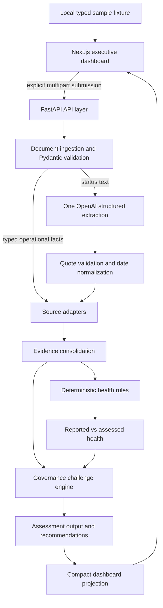

# Architecture

## System overview

ProgramPulse is a local delivery-assurance prototype with a Next.js frontend and
FastAPI backend. **AI interpretation != governance decisioning.** The model extracts
claims and observations from a narrative; operational facts and explicit policies
control health. No database or background agent is involved.

## Components and responsibilities

- **Frontend:** `frontend/components/` displays statuses, challenges, actions and
  provenance. `lib/` owns typed sample data, response validation and explicit API
  calls. It does not assign health. Sample loads without a request.
- **API layer:** `backend/app/api/` maps HTTP requests/errors and closes uploads.
  `main.py` mounts routes, body limits and explicit development CORS.
- **Document ingestion:** `ingestion/` reads DOCX body paragraphs/tables, embedded
  PDF text, UTF-8 text/CSV and the first XLSX worksheet. The field mapper handles
  known aliases and conservative type conversions. All four sources must form a
  valid, consistent snapshot before AI is called.
- **AI evidence extraction:** `services/openai_evidence_extractor.py` owns the sole
  provider boundary, Pydantic structured parsing, grounding checks and diagnostics.
- **Normalization:** `evidence_normalizer.py` checks source support and resolves
  partial dates only with sufficiently clear context. Missing information stays unknown.
- **Adapters:** `evidence_adapters.py` maps both branches into canonical evidence,
  retaining structured policy facts and source locations.
- **Evidence consolidation:** `evidence_consolidation.py` associates event keys
  while preserving distinct records and dimensional relevance. It does not add
  risk scores or sum repeated defect mentions.
- **Rules engine:** `health_rules.py` evaluates explicit predicates as of the
  reporting date, not the wall clock. Canonical operational metadata supplies the
  same typed rule facts used by the compatibility endpoint.
- **Assessment orchestrator:** `assessment_orchestrator.py` coordinates one
  extraction, normalization, consolidation, rules and output; it owns no health policy.
- **Governance challenge engine:** `governance_challenges.py` compares retained
  claims to findings. `challenge_consolidation.py` merges equivalent conflicts
  while retaining evidence/provenance and the highest applicable severity.
- **Output/projection:** `assessment_output.py` builds the audit representation and
  deterministic recommendations/summary. `dashboard_assessment.py` projects an
  existing result into `DashboardAssessment` without another model call.

## Health and precedence

An open critical dependency that is overdue without a committed resolution date
makes Dependencies RED. Critical-path slippage of at least three days, or an
unknown forecast on an overdue critical-path milestone, makes Schedule AMBER.
Quality rules consider unresolved defects and incomplete validation. Unassessed
material scope changes, overdue important actions and un-escalated material
exposure affect Scope, Actions and Governance respectively.

Any adverse dimension prevents overall GREEN. An explicit active release-blocker
signal produces overall RED; otherwise adverse findings produce AMBER. Thresholds
are initial policies, not a predictive release-risk model.

Validated operational facts control rule decisions. AI severity hints and
extraction confidence cannot directly set health. Claims remain alongside findings;
structured precedence does not establish that the underlying system is correct.
Conflicting extracted project/date/health metadata is rejected.

## Evidence identity and provenance

Canonical records have deterministic IDs, optional event keys, dimensions, kind,
description and original source references. Exact duplicate records are idempotent;
different occurrences retain their locations. Narrow key/label matching associates
related events; ambiguous matches remain separate. There is no fuzzy evidence graph.

JSON retains pointers. Tabular evidence retains filename, sheet and original row,
with column mapping in normalized metadata. Narrative evidence retains filename,
section and verified snippet; extraction indices do not pretend to be PDF coordinates.
Dimension `reason_details` tie each reason to its own evidence IDs. Challenges
reference both claims and counter-evidence; actions reference triggering evidence.

## Response boundaries and compatibility

`ProgramAssessment` contains the complete `evidence_catalog`, reasons, event groups,
challenges and usage. Compatibility fields are retained. `DashboardAssessment`
contains six dimension summaries, up to five challenges/actions and up to eight
compact key-evidence records. Its shortlist need not contain every referenced ID.

Uploaded assessments return the compact model. The detailed demo and compact demo
routes remain separate; requesting both separately runs extraction twice. The
original deterministic sample endpoint and standalone extraction routes remain
available. See [API reference](api-reference.md).

## Lifecycle and operational boundaries

Files are bounded, parsed and closed without permanent storage. Rejected inputs
never reach extraction. Provider errors are mapped to safe HTTP responses. Browser
and provider timeouts are distinct; disconnecting does not guarantee cancellation.
There is no shared cache, persistent history, authentication, distributed job queue
or production deployment layer. See [security](security-and-ai.md) and
[format limitations](enterprise_ingestion.md).
